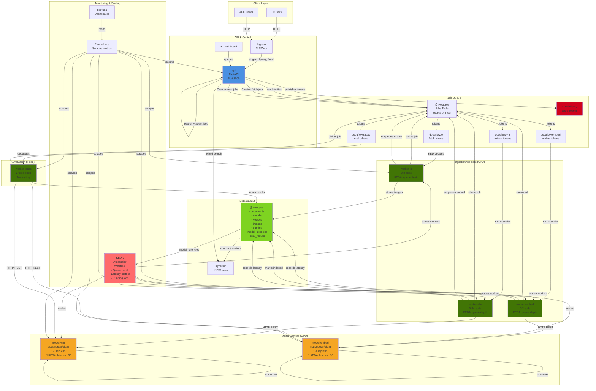
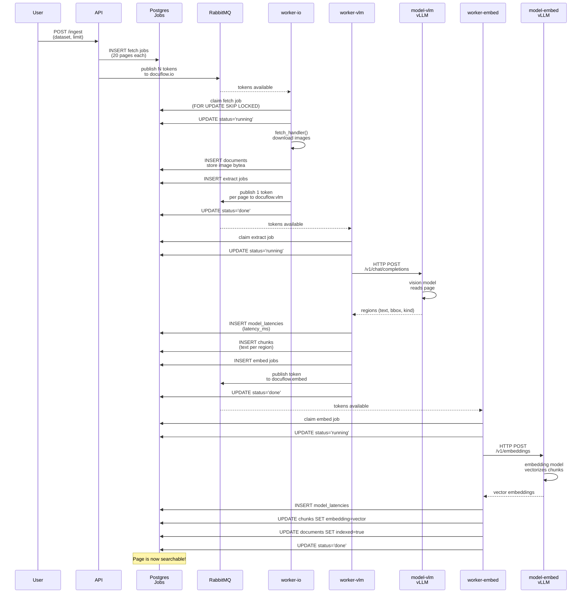
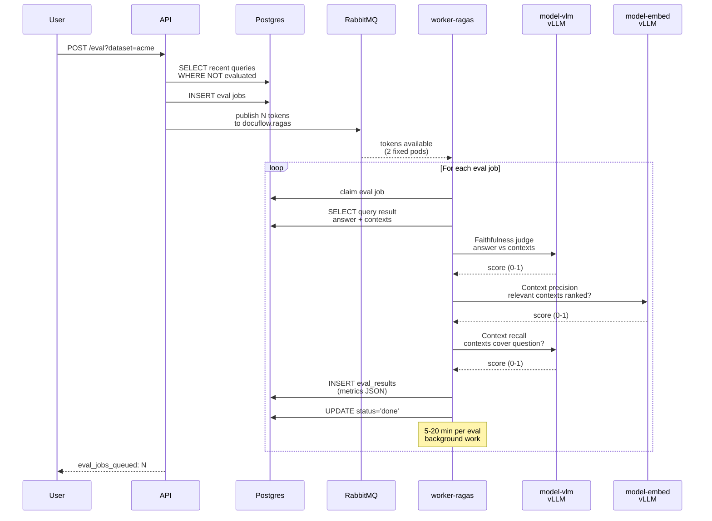
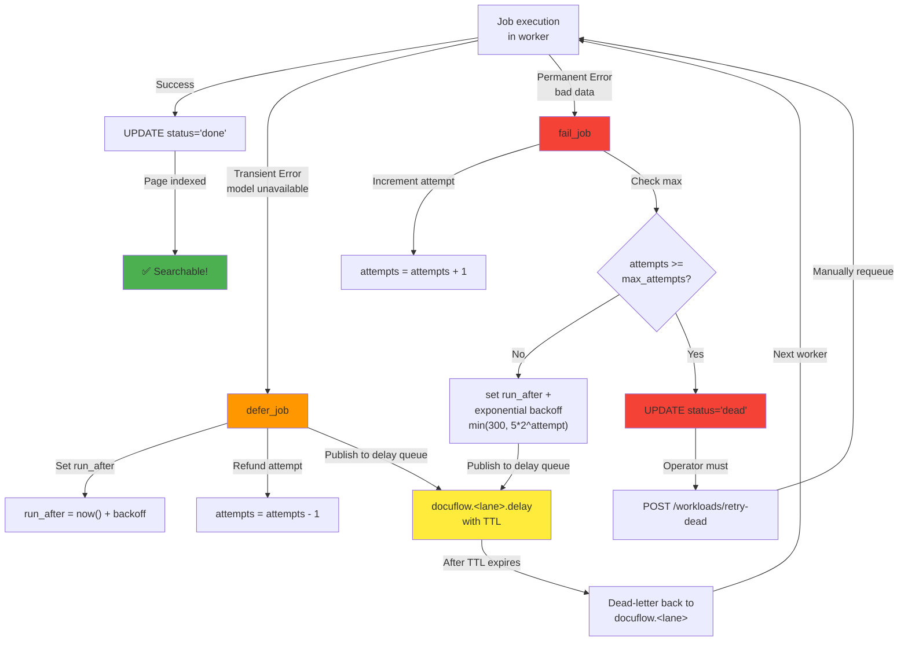

# DocuFlow Complete Architecture Diagram

## System Overview



## Data Flow Sequences

### 1. Ingest Flow



### 2. Query Flow

```mermaid
sequenceDiagram
    participant User
    participant API
    participant Search as Search<br/>pgvector
    participant LLM as model-llm<br/>vLLM
    participant Postgres
    participant Cache as Response Cache

    User->>API: POST /query<br/>(question)
    API->>Postgres: INSERT inflight<br/>(beat=now)
    
    API->>Search: hybrid search<br/>(vector + full-text)
    Search-->>API: top-k chunks<br/>(with doc_id, excerpt)
    
    API->>Postgres: INSERT INTO queries<br/>(question, trace=pending)
    
    loop Agent Loop (max 4 steps)
        API->>LLM: HTTP POST /v1/chat/completions<br/>context + question
        LLM-->>API: thought + action<br/>(search/read_page/answer)
        
        alt action == "search"
            API->>Search: refine search<br/>(follow-up query)
        else action == "read_page"
            API->>Search: full page text
        else action == "answer"
            break
        end
    end
    
    API->>LLM: Generate final answer<br/>with citations
    LLM-->>API: answer + citations
    API->>Postgres: UPDATE queries<br/>(answer, citations, trace)
    API->>Postgres: DELETE inflight
    
    API-->>User: answer + citations<br/>+ trace

    Note over API,LLM: Total latency SLO: p95 ≤ 15s<br/>during ingest
```

### 3. Evaluation (RAGAS) Flow



## Component Details

### API Pod
- **Role:** HTTP endpoint, query agent, job creation
- **Scaling:** KEDA on CPU + queries in flight (min 1, max 8)
- **Responsibilities:**
  - `POST /ingest` → creates fetch jobs, publishes tokens
  - `POST /query` → runs agent loop with search + LLM
  - `POST /eval` → creates eval jobs, publishes tokens
  - Hybrid search (vector + full-text)

### worker-io
- **Role:** Fetch pages from dataset source
- **Scaling:** KEDA on `docuflow.io` queue depth (min 0, max 3)
- **Resources:** 200m CPU, 512Mi memory
- **Job:** fetch → downloads images, stores in Postgres, enqueues extract
- **Throughput:** ~20 pages per job, 1-2 jobs per pod

### worker-vlm
- **Role:** Page reading with vision model
- **Scaling:** KEDA on `docuflow.vlm` queue depth (min 0, max 24)
- **Resources:** 100m CPU, 256Mi memory
- **Job:** extract → calls model-vlm REST API, records latency, enqueues embed
- **Latency:** Recorded → drives model-vlm GPU scaling
- **Throughput:** ~1 page per 40-80s (depends on page complexity)

### worker-embed
- **Role:** Vectorize chunks
- **Scaling:** KEDA on `docuflow.embed` queue depth (min 0, max 3)
- **Resources:** 100m CPU, 256Mi memory
- **Job:** embed → calls model-embed REST API, records latency, marks page indexed
- **Latency:** Recorded → drives model-embed GPU scaling
- **Throughput:** ~10-100 chunks per second (batched)

### worker-ragas
- **Role:** Background evaluation
- **Scaling:** **FIXED 2 pods** (never scales)
- **Resources:** 200m CPU, 512Mi memory
- **Job:** eval → runs RAGAS pipeline, stores metrics
- **Duration:** 5-20 minutes per query evaluation
- **Note:** Never blocks user queries (separate lane)

### model-vlm (vLLM)
- **Model:** Qwen2.5-VL-3B (vision model)
- **Port:** 8000
- **API:** OpenAI-compatible `/v1/chat/completions`
- **Scaling:** KEDA on latency p95 (min 1, max 8)
  - **Threshold:** scale up if p95 > 5 seconds
  - **Activation:** scale down if p95 < 2 seconds
- **GPU Memory:** ~8GB per replica on L40S
- **Concurrency:** 16 requests per replica (batch slots)

### model-embed (vLLM)
- **Model:** Qwen3-Embedding-0.6B
- **Port:** 8001
- **API:** OpenAI-compatible `/v1/embeddings`
- **Scaling:** KEDA on latency p95 (min 1, max 4)
  - **Threshold:** scale up if p95 > 3 seconds
  - **Activation:** scale down if p95 < 1.5 seconds
- **GPU Memory:** ~2GB per replica on L40S
- **Concurrency:** 32+ requests per replica (lightweight)

### Postgres
- **Role:** Source of truth for all state
- **Tables:**
  - `jobs` → queue state (status, lease, retries)
  - `documents` → pages (id, dataset, image, status)
  - `chunks` → text regions with vectors
  - `queries` → question/answer logs with traces
  - `model_latencies` → latency metrics for KEDA
  - `eval_results` → RAGAS evaluation scores
- **Scaling:** Single node (HA possible with replicas)
- **Pool:** Min 1, max 8 connections per worker

### RabbitMQ
- **Role:** Work token queue (NOT job store)
- **Queues:**
  - `docuflow.io` → fetch tokens
  - `docuflow.vlm` → extract tokens
  - `docuflow.embed` → embed tokens
  - `docuflow.ragas` → eval tokens
- **Delay Queues:** `*.delay` for retry backoff
- **Persistence:** Durable queues (survive restart)
- **Reconciliation:** Workers rebuild tokens from Postgres if lost

## Latency Metrics & KEDA Decisions

```mermaid
graph LR
    subgraph "Latency Recording"
        L1["extract handler<br/>calls model-vlm"]
        L2["records latency<br/>model_latencies table"]
        L3["p95 = PERCENTILE_CONT<br/>over 2-min window"]
    end

    subgraph "KEDA Decision"
        K1["KEDA queries Postgres<br/>every 15 seconds"]
        K2["Reads p95_latency<br/>from model_latencies"]
        K3["Compare vs threshold<br/>5000ms"]
        K4["Scale decision:<br/>+2 pods or -1 pod"]
    end

    subgraph "GPU Scaling"
        S1["model-vlm replicas<br/>increase from 2→4"]
        S2["vLLM batch slots<br/>increase available"]
        S3["latency drops<br/>requests finish faster"]
    end

    L1 -->|measures| L2
    L2 -->|aggregates| L3
    L3 -->|provides signal to| K1
    K1 -->|fetches| K2
    K2 -->|compares| K3
    K3 -->|triggers| K4
    K4 -->|scales| S1
    S1 -->|increases| S2
    S2 -->|causes| S3
    S3 -->|feeds back to| L3

    style L1 fill:#417505
    style L2 fill:#7ed321
    style L3 fill:#7ed321
    style K1 fill:#ff6b6b
    style K2 fill:#7ed321
    style K3 fill:#ff6b6b
    style K4 fill:#ff6b6b
    style S1 fill:#f5a623
    style S2 fill:#f5a623
    style S3 fill:#f5a623
```



## Retry & Backoff Logic


