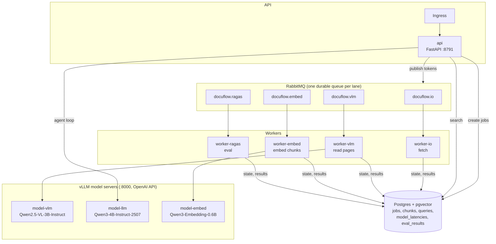
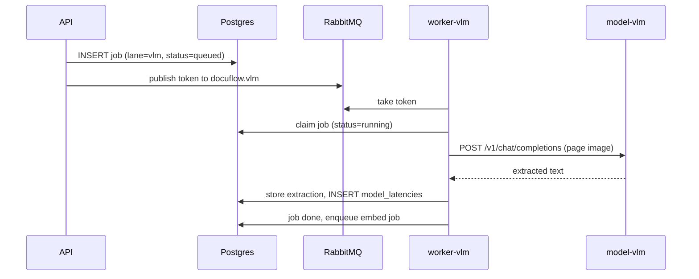

# DocuFlow: Document Ingestion & RAG on Kubernetes

DocuFlow reads scanned documents with a vision model, indexes them in Postgres + pgvector, and answers questions with a small agent loop. Ingest, query and evaluation share the GPUs, and each one scales on its own signal.

## Contents

1. [Architecture](#architecture)
2. [Pipelines](#pipelines)
3. [Scaling](#scaling)
4. [Measured performance](#measured-performance)
5. [Deploy](#deploy)
6. [Monitor](#monitor)
7. [Troubleshoot](#troubleshoot)
8. [Adding an LLM gateway](#adding-an-llm-gateway)
9. [Files](#files)

---

## Architecture



Postgres is the source of truth for job state. A RabbitMQ message is only a *token* that says "a runnable job exists in this lane". Workers claim the real job row in Postgres. KEDA reads the queue length, and `broker.reconcile()` tops the queue up again if tokens are lost.

Every model call goes through `docuflow/llm.py`, which looks up the endpoint for the role in `config.ENDPOINTS`. Page-read and embed calls also write their latency to `model_latencies`; the gc CronJob keeps the last 24 h (`GC_LATENCIES_HOURS`). vLLM never writes to Postgres.

### One page, end to end



---

## Pipelines

| Pipeline | Path | Trigger |
|---|---|---|
| **Ingest** | `fetch` (worker-io) → `extract` (worker-vlm → model-vlm) → `embed` (worker-embed → model-embed) → `chunks` | `POST` ingest via API |
| **Query** | api → vector search in pgvector → agent loop on model-llm (can call model-vlm to look at a page) → answer + sources | `POST` query |
| **Eval** | `POST /eval` → one `eval` job per answered query not yet evaluated → worker-ragas scores it → `eval_results` | manual |

worker-ragas scores each query with RAGAS **faithfulness** and **answer relevancy**. These metrics need no reference answer. The judge is the agent model, and the contexts are the observations the agent actually saw, taken from the query trace. Queries with no retrieved context are stored as `{"skipped": ...}`. The metrics that need reference answers (context precision and recall) stay in the offline `evals/ragas_eval.py`.

RAGAS is installed in the image by default (`WITH_EVAL=1` in the Dockerfile). To build a slimmer image without it, pass `--build-arg WITH_EVAL=0`.

---

## Scaling

| Workload | Scaler (`k8s/base/keda.yaml`) | Min → Max | Signal |
|---|---|---|---|
| worker-vlm | KEDA | 0 → 24 | `docuflow.vlm` queue length + running vlm jobs |
| worker-embed | KEDA | 0 → 3 | `docuflow.embed` queue + running jobs |
| worker-io | KEDA | 0 → 3 | `docuflow.io` queue + running jobs |
| api | KEDA | 1 → 8 | queries in flight |
| worker-ragas | none (fixed) | 2 | — |
| model-vlm / model-embed | KEDA (`k8s/components/models/autoscaling.yaml`) | 1 → 2 | vLLM in-flight requests per replica (Prometheus, threshold 4) |

Ingest workers scale to zero 60 s after their queue drains (`cooldownPeriod: 60`). Model servers keep at least one replica, so the GPUs are **not** released when the system is idle.

---

## Measured performance

All runs used one L40S with real models. Source: [`blog/06-stress-tests.md`](blog/06-stress-tests.md) and `docs/stress-report-run1.md`.

| Run | Ingest throughput |
|---|---|
| Run 1 (in-app worker cap of 8) | 34 pages/min |
| Run 2 (cap fixed) | 56.5 pages/min |
| Ingest mode: 3 vLLM replicas, 48 workers, easy printed pages | ~170 pages/min |
| Same setup, scans and forms only (GPU compute-bound) | ~74 pages/min |

Query latency during the run-1 ingest was p50 9.6 s, p95 16.6 s and max 25.2 s.

Throughput depends on the page mix more than on the replica count. Do not quote cost-per-page or capacity numbers until they have been measured.

---

## Deploy

### Prerequisites
- Kubernetes 1.28+ with KEDA installed
- NVIDIA device plugin and a GPU node for the real-model overlays (`deploy/helm-values/`)
- A `docuflow-secrets` Secret with `DOCUFLOW_DSN`, `POSTGRES_PASSWORD`, `RABBITMQ_URL`, `RABBITMQ_PASSWORD`, and optionally `DOCUFLOW_API_KEY`, `LLM_API_KEY`, `HF_TOKEN`

### Apply an overlay

Everything is installed into the `docuflow` namespace through kustomize:

```bash
kubectl apply -k k8s/overlays/ci-sim      # simulated models, no GPU (CI)
kubectl apply -k k8s/overlays/local-gpu   # real vLLM models on one GPU
kubectl apply -k k8s/overlays/prod        # prod sizing
```

### Verify

```bash
kubectl -n docuflow get pods
kubectl -n docuflow get scaledobjects
kubectl -n docuflow port-forward svc/model-vlm 8000:8000 &
curl -s localhost:8000/metrics | grep -E 'vllm:num_requests_(running|waiting)'
```

---

## Monitor

**Ingest throughput (jobs finished per minute, by stage)**
```sql
SELECT stage, count(*) / 5.0 AS jobs_per_min
FROM jobs
WHERE status = 'done' AND finished_at > now() - interval '5 minutes'
GROUP BY stage;
```

**Model latency p95 (extract and embed calls)**
```sql
SELECT stage, endpoint,
       percentile_cont(0.95) WITHIN GROUP (ORDER BY latency_ms) AS p95_ms,
       count(*) AS calls
FROM model_latencies
WHERE ts > now() - interval '2 minutes'
GROUP BY stage, endpoint;
```

**Backlog per lane**
```sql
SELECT lane,
       count(*) FILTER (WHERE status = 'queued')  AS queued,
       count(*) FILTER (WHERE status = 'running') AS running,
       count(*) FILTER (WHERE status = 'dead')    AS dead
FROM jobs
GROUP BY lane;
```

Prometheus alerts and the Grafana dashboard are defined in `k8s/components/monitoring/`.

---

## Troubleshoot

**Model calls are slow**
```bash
kubectl -n docuflow get pods -l app=model-vlm
kubectl -n docuflow get hpa                        # KEDA creates HPAs named keda-hpa-<scaledobject>
kubectl -n docuflow exec deploy/model-vlm -- curl -s localhost:8000/metrics | grep vllm:num_requests_waiting
```

**Workers are idle while jobs are queued**
```bash
kubectl -n docuflow exec rabbitmq-0 -- rabbitmqctl list_queues name messages
kubectl -n docuflow get scaledobject worker-vlm
kubectl -n docuflow logs deploy/worker-vlm --tail=50
```
If the queue is empty but `jobs` still has `queued` rows, check whether the lane or dataset is paused (`control` table, key `paused`). If it isn't paused, `reconcile()` should republish the tokens on the next worker loop.

**Jobs end up `dead`**: look at `jobs.error` and `jobs.attempts`. The `outages` column counts deferrals that were caused by model-server outages.

---

## Adding an LLM gateway

The app talks to each model role (`vlm`, `llm`, `embed`) through an OpenAI-compatible base URL and key (`VLM_BASE_URL`, `VLM_API_KEY`, … in `config.py`). To put a gateway such as LiteLLM, or llm-d's Gateway API Inference Extension (`InferencePool` + endpoint picker), in front of the vLLM servers:

1. Deploy the gateway in the `docuflow` namespace as a kustomize component.
2. Patch the `*_BASE_URL` values in that component, the same way `k8s/components/models/kustomization.yaml` does today.
3. Point the model names at whatever the gateway exposes.

No code changes are needed. A previous draft gateway manifest was removed because it used APIs that don't exist upstream.

---

## Files

| Path | Purpose |
|---|---|
| `docuflow/config.py` | Runtime config (env vars, `ENDPOINTS` per model role) |
| `docuflow/llm.py` | Model client and latency recording |
| `docuflow/broker.py` | RabbitMQ tokens, lanes, `reconcile()` |
| `docuflow/pipeline.py` | Stage handlers: fetch, extract, embed, eval (RAGAS) |
| `docuflow/db.py` | Schema |
| `k8s/base/` | Namespace-neutral core (kustomize) |
| `k8s/components/models/` | vLLM model servers and their autoscaling |
| `k8s/components/monitoring/` | Alerts and dashboard |
| `k8s/overlays/{ci-sim,local-gpu,prod}` | Deployable environments |
| `docs/stress-report-run1.md` | Source of the performance numbers |
