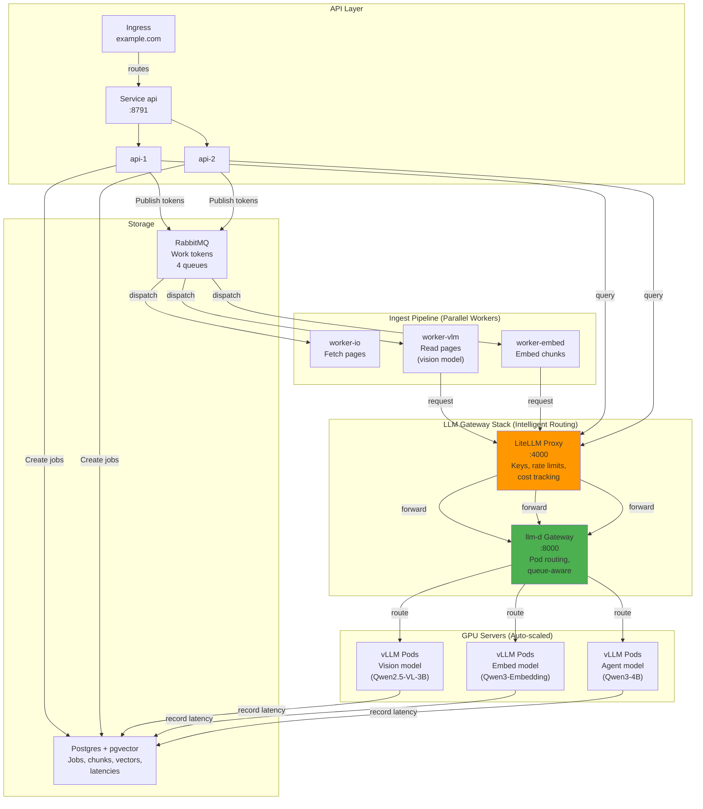
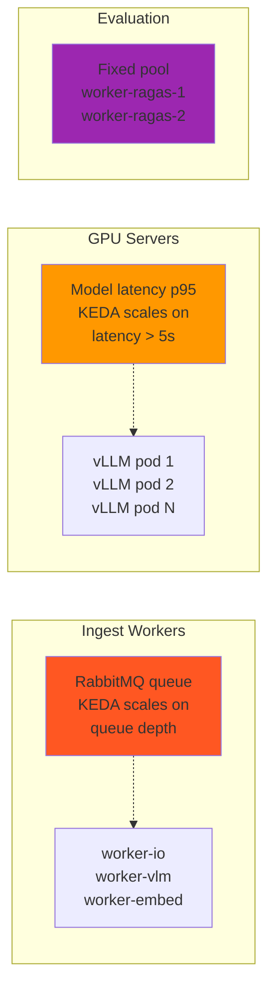
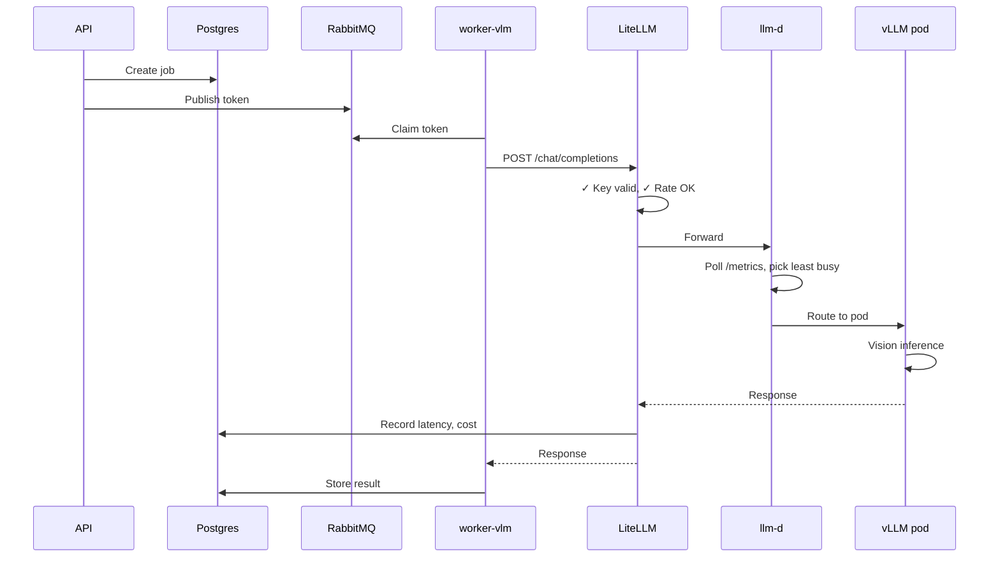
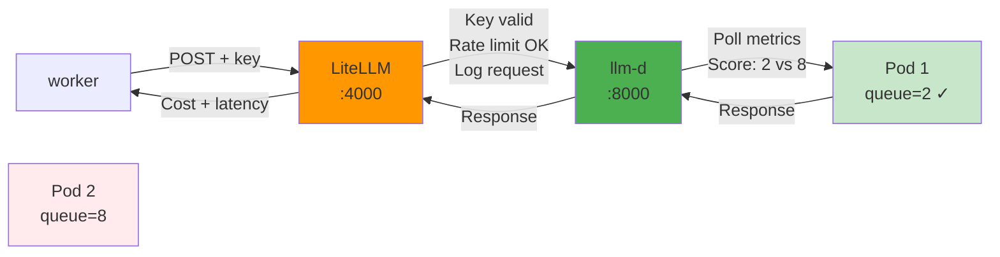
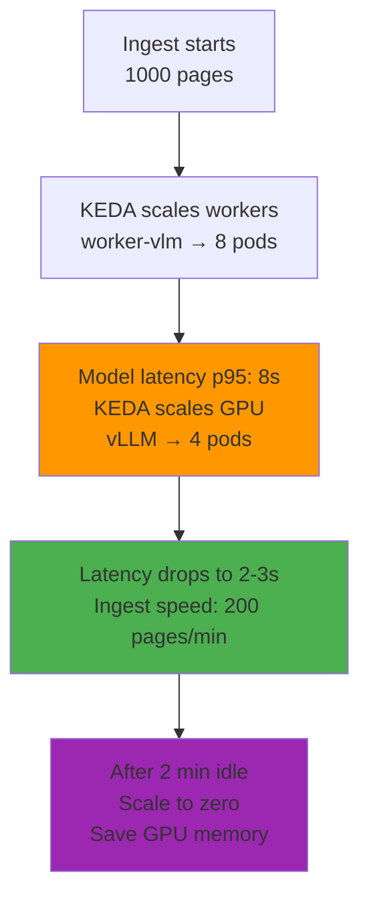

# DocuFlow: Document Ingestion & RAG on Kubernetes

Read scanned documents with a vision model, make them searchable, and answer questions. Scales from zero to 200 pages/min on a single GPU.

---

## Table of Contents

1. [System Architecture](#system-architecture)
2. [How It Works](#how-it-works)
3. [Deployment](#deployment)
4. [Monitoring](#monitoring)
5. [Troubleshooting](#troubleshooting)
6. [Scaling & Tuning](#scaling--tuning)

---

## System Architecture



### Three Workloads, One GPU



### One Request Flow



---

## How It Works

### The Three Pipelines

**1. Ingest: Read & Index**
```
PDF → worker-io (fetch pages) 
    → worker-vlm (vision: read text via LiteLLM+llm-d+vLLM)
    → worker-embed (embeddings)
    → Postgres (chunks + vectors)
```
Scales on: RabbitMQ queue depth (0 to 16+ pods)  
Speed: 100-200 pages/min on one GPU

**2. Query: Agent Loop**
```
Question → api (search vectors)
        → vLLM agent (answer via LiteLLM+llm-d+vLLM)
        → Sources + answer
```
Scales on: Query latency p95 (1 to 8 GPU pods)  
Latency: <15s p95 during ingest

**3. Eval: Quality Metrics**
```
Results → worker-ragas (RAGAS evaluation)
       → Postgres (faithfulness, relevancy, context)
```
Fixed: 2 workers (not auto-scaled)

### Gateway: LiteLLM + llm-d

All requests go through **two intelligent layers**:



**Layer 1 (LiteLLM):** API keys, rate limits, cost tracking, logging  
**Layer 2 (llm-d):** Pod discovery, queue-aware routing, health checks

### Scaling Behavior



---

## Performance

| Metric | Value | Notes |
|--------|-------|-------|
| Ingest speed | 100-200 pages/min | Single GPU, parallel workers |
| Extract latency p95 | 2-5 sec | Per page |
| Query latency p95 | <15 sec | During ingest |
| Cost per page | $0.01-0.05 | Model dependent |
| Max concurrent docs | 10,000+ | Limited by Postgres |
| Min GPU | 1x L40S 46GB | Or equivalent NVIDIA |

---

## Tech Stack

| Layer | Tech | Why |
|-------|------|-----|
| API | Python FastAPI | Simple, async I/O |
| Queue | RabbitMQ | Work tokens (KEDA scales on it) |
| Jobs | Postgres + pgvector | Source of truth for job state & vectors |
| Models | vLLM (Qwen models) | Fast inference, continuous batching |
| Routing | LiteLLM + llm-d | App policy + K8s intelligence |
| Scaling | KEDA | Reacts to queue depth & latency |
| Orchestration | Kubernetes | Pod scaling, networking |

---

## Deployment

### Prerequisites
- Kubernetes 1.28+
- Postgres 14+
- RabbitMQ 3.13+
- 1x NVIDIA GPU (L40S recommended)

### Deploy Everything (3 Commands)

```bash
# 1. Deploy stack (LiteLLM + llm-d + vLLM + KEDA)
kubectl apply -f k8s/base/llm-stack-combined.yaml

# 2. Deploy workers and API
kubectl apply -f k8s/base/workers.yaml
kubectl apply -f k8s/base/api.yaml

# 3. Patch workers to use LiteLLM
kubectl patch deployment worker-vlm -p '{"spec":{"template":{"spec":{"containers":[{"name":"worker","envFrom":[{"configMapRef":{"name":"docuflow-config-litellm"}},{"secretRef":{"name":"docuflow-secrets"}}]}]}}}}'

kubectl patch deployment worker-embed -p '{"spec":{"template":{"spec":{"containers":[{"name":"worker","envFrom":[{"configMapRef":{"name":"docuflow-config-litellm"}},{"secretRef":{"name":"docuflow-secrets"}}]}]}}}}'
```

### Verify

```bash
# Check pods
kubectl get pods
# Should see: litellm-proxy, model-vlm, worker-vlm, worker-embed, api, postgres, rabbitmq

# Check gateway
kubectl get gateway llm-d-gateway
# Should show: Ready

# Check metrics
kubectl port-forward model-vlm-0 8000:8000 &
curl localhost:8000/metrics | grep queue_depth
```

---

## Monitoring

### 3 Key SQL Queries

**1. Ingest Speed (Pages/Sec)**
```sql
SELECT 
  COUNT(*) / EXTRACT(EPOCH FROM (max(updated_at) - min(updated_at))) as pages_per_sec
FROM jobs
WHERE status = 'done' AND updated_at > now() - interval '5 minutes';
```
Target: 2-3 pages/sec (120-180 pages/min)

**2. GPU Latency (p95)**
```sql
SELECT 
  stage,
  PERCENTILE_CONT(0.95) WITHIN GROUP (ORDER BY latency_ms) as p95_ms,
  COUNT(*) as requests
FROM model_latencies
WHERE ts > now() - interval '2 minutes'
GROUP BY stage;
```
Target: extract < 5000ms, embed < 3000ms

**3. Queue Depth & Running Jobs**
```sql
SELECT 
  COUNT(*) FILTER(WHERE status='queued') as queued,
  COUNT(*) FILTER(WHERE status='running') as running
FROM jobs
WHERE created_at > now() - interval '1 hour';
```
Target: queued < 100, running matches worker pods

### Logs to Watch

```bash
# LiteLLM: Key validation, rate limits, cost
kubectl logs -f deployment/litellm-proxy

# llm-d: Pod routing decisions
kubectl logs -f deployment/llm-d-controller -n kube-system

# Workers: Job processing
kubectl logs -f deployment/worker-vlm

# GPU latency
kubectl exec -it model-vlm-0 -- curl localhost:8000/metrics | grep -E "queue|cache"
```

---

## Troubleshooting

### "Requests are slow (p95 > 5s)"

1. Check GPU pod count:
   ```bash
   kubectl get pods -l app=model-vlm
   ```

2. Check KEDA is working:
   ```bash
   kubectl describe hpa model-vlm-latency | grep -A 5 "Current"
   ```

3. Check vLLM metrics:
   ```bash
   kubectl exec -it model-vlm-0 -- curl localhost:8000/metrics | grep queue_depth
   ```

4. Restart if metrics are stale:
   ```bash
   kubectl delete pods -l app=model-vlm
   ```

### "Workers aren't processing"

1. Check queue has tokens:
   ```bash
   kubectl exec -it rabbitmq-0 -- rabbitmqctl list_queues name messages
   # Should show vlm queue with pending messages
   ```

2. Check workers are running:
   ```bash
   kubectl get deploy worker-vlm -o jsonpath='{.status.desiredReplicas},{.status.readyReplicas}'
   ```

3. Check worker logs:
   ```bash
   kubectl logs deployment/worker-vlm | head -20
   # Look for connection errors
   ```

### "LiteLLM is rejecting requests"

1. Check key validation:
   ```bash
   kubectl logs deployment/litellm-proxy | grep -i "401\|unauthorized"
   ```

2. Check rate limit:
   ```bash
   kubectl logs deployment/litellm-proxy | grep -i "429\|rate_limit"
   ```

3. Check backend is responding:
   ```bash
   kubectl logs deployment/litellm-proxy | grep -i "llm-d\|gateway\|error"
   ```

---

## Scaling & Tuning

### Increase Ingest Speed

1. Add more worker pods:
   ```bash
   kubectl scale deploy worker-vlm --replicas=16
   ```

2. Increase GPU pods:
   ```bash
   # Edit k8s/base/llm-stack-combined.yaml
   # In KEDA ScaledObject: maxReplicaCount: 8 → 12
   kubectl apply -f k8s/base/llm-stack-combined.yaml
   ```

3. Increase batch size:
   ```bash
   # Edit vLLM StatefulSet args
   # --max-num-batched-tokens=8192 → 16384
   kubectl apply -f k8s/base/llm-stack-combined.yaml
   ```

### Reduce Costs

1. **Scale to zero when idle:** Already enabled (2min cooldown)

2. **Use smaller model:**
   ```bash
   # Edit k8s/base/llm-stack-combined.yaml
   # VLM_MODEL: "Qwen2.5-VL-3B" → "Qwen2.5-VL-2B"
   ```

3. **Reduce eval frequency:**
   ```bash
   # Only evaluate 10% of queries instead of 100%
   # Edit pipeline.py: if random.random() < 0.1
   ```

### Configuration Tuning Points

**Rate Limits (LiteLLM):**
```yaml
# In llm-stack-combined.yaml ConfigMap
rate_limit_models:
  - model: "extract"
    requests_per_second: 100  # ← Adjust
  - model: "embed"
    requests_per_second: 200
```

**Routing Strategy (llm-d):**
```yaml
# In LLMServicePolicy
routing:
  strategy: "least_pending_requests"  # Options: round_robin, least_connections
  metrics:
    - type: "vllm_queue_depth"
    - type: "vllm_kv_cache_utilization"
```

**GPU Scaling Threshold (KEDA):**
```yaml
# In KEDA ScaledObject
triggers:
  - type: postgresql
    metadata:
      targetQueryValue: "5000"  # Scale when p95 > 5000ms
      minReplicaCount: 1
      maxReplicaCount: 8
```

---

## Cost Analysis

```sql
-- Cost by model over last hour
SELECT 
  stage,
  COUNT(*) as requests,
  ROUND(AVG(latency_ms)::numeric, 0) as avg_latency_ms,
  SUM(COUNT(*)) OVER () as total_requests
FROM model_latencies
WHERE ts > now() - interval '1 hour'
GROUP BY stage;
```

**Optimization Strategy:**
- If ingest-heavy: More worker pods (cheap), fewer GPU pods
- If query-heavy: Fewer worker pods, more GPU pods
- If balanced: Fix GPU at 4 pods + dynamic worker scaling

---

## Files Reference

| File | Purpose |
|------|---------|
| `k8s/base/llm-stack-combined.yaml` | Complete stack manifest |
| `k8s/base/workers.yaml` | Worker & API deployments |
| `k8s/APPLY_LITELLM_STACK.md` | Deployment step-by-step guide |
| `docs/LITELLM_LLMD_SETUP.md` | Gateway detailed config |
| `docuflow/llm.py` | Model client (configurable) |
| `docuflow/config.py` | Runtime config (env vars) |

---

## Example: Ingest 100-Page Document

1. **API:** Create job (PDF, pages 1-100)
2. **worker-io:** Fetch pages (~1-2s per page)
3. **worker-vlm:** Read text with vision model via LiteLLM→llm-d→vLLM (~2-5s per page)
   - Queue depth triggers worker scaling
   - Latency triggers GPU scaling
4. **worker-embed:** Embed 5000 chunks (~100ms per chunk)
5. **Postgres:** Store vectors for search
6. **worker-ragas:** Evaluate quality (30-60s total)
7. **Done:** Document searchable + queryable in ~10 minutes

Meanwhile, **queries are handled** on separate GPU pods (agent model) without blocking ingest.

---

## Next Steps

1. **Deploy** with the 3 commands above
2. **Monitor** with the 3 SQL queries (every 5 minutes)
3. **Scale** based on queue depth & latency
4. **Optimize** worker/GPU counts for your workload

Questions? Check the detailed guides:
- `k8s/APPLY_LITELLM_STACK.md` – Step-by-step deployment
- `docs/LITELLM_LLMD_SETUP.md` – Gateway configuration
