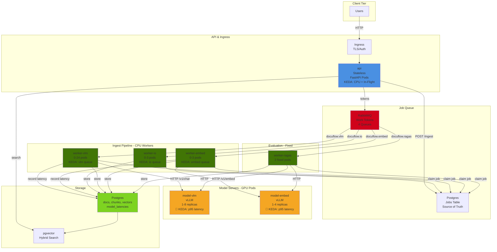
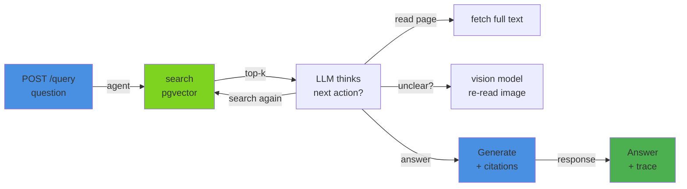
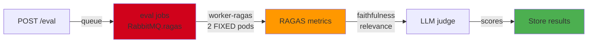
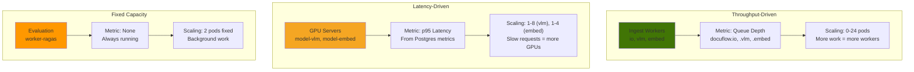
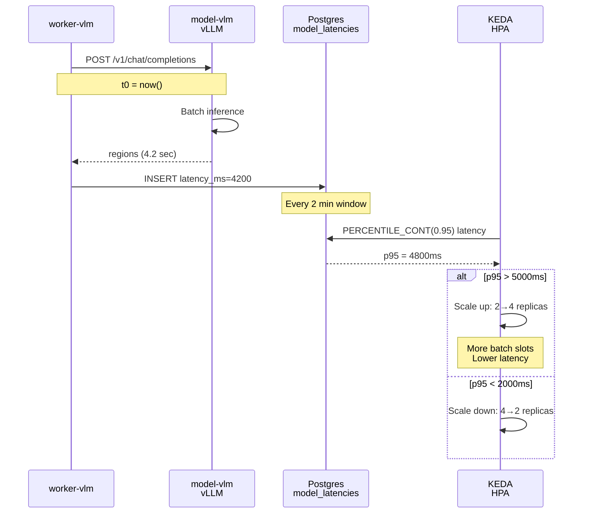

# DocuFlow: Document Ingestion & RAG at Scale

**What:** Vision model reads scanned documents → searchable knowledge base → agent answers questions with citations.  
**Why:** Ingest and queries run in parallel on a single GPU.  
**How:** Three pipelines, three scaling strategies, all on Kubernetes.

---

## System Architecture



---

## Three Pipelines

### 1. Ingest Pipeline

```mermaid
graph LR
    A["POST /ingest<br/>100 pages"] -->|batch| B["fetch jobs<br/>RabbitMQ.io"]
    B -->|worker-io<br/>0-3 pods| C["Download<br/>Store images"]
    C -->|per page| D["extract jobs<br/>RabbitMQ.vlm"]
    D -->|worker-vlm<br/>0-24 pods| E["model-vlm<br/>vLLM pod"]
    E -->|REST API| F["Regions<br/>bbox + text"]
    F -->|chunk| G["embed jobs<br/>RabbitMQ.embed"]
    G -->|worker-embed<br/>0-3 pods| H["model-embed<br/>vLLM pod"]
    H -->|REST API| I["Vectors"]
    I -->|indexed| J["✓ Searchable"]
    
    style B fill:#d0021b
    style D fill:#d0021b
    style G fill:#d0021b
    style E fill:#f5a623
    style H fill:#f5a623
    style J fill:#4caf50
```


**Scaling:** KEDA watches RabbitMQ queue depth  
**Metric:** Pages queued = worker pods needed  

---

### 2. Query Pipeline


**Scaling:** KEDA watches CPU + queries in-flight  
**Metric:** User load = API pods needed  

---

### 3. Evaluation Pipeline


**Scaling:** Fixed 2 pods (no autoscaling)  
**Why:** Background work, no SLA  

---

## Three Scaling Strategies



---

## Latency-Driven GPU Scaling



---

## Data Model

```
📦 Postgres
├─ documents (id, dataset, image, status)
├─ chunks (doc_id, text, embedding vector)
├─ jobs (id, stage, lane, status, lease, attempts)
├─ model_latencies (stage, endpoint, latency_ms, ts) ← NEW
├─ eval_results (job_id, metrics) ← NEW
└─ pgvector indexes (HNSW + GIN)

🐰 RabbitMQ
├─ docuflow.io (fetch tokens)
├─ docuflow.vlm (extract tokens)
├─ docuflow.embed (embed tokens)
├─ docuflow.ragas (eval tokens) ← NEW
└─ *.delay (retry backoff)
```

---

## Key Insights

| Aspect | Insight |
|--------|---------|
| **Postgres** | Source of truth (jobs, latency, state) |
| **RabbitMQ** | Work tokens (not jobs themselves) |
| **REST APIs** | vLLM called via HTTP, not queue-based |
| **Latency Metrics** | Recorded by workers, read by KEDA |
| **Three Queues** | Ingest stages pipeline (io → vlm → embed) |
| **Three Scaling** | Queue depth + Latency + Fixed = right metric for each |

---

## Deploy & Test

```bash
# Deploy
kubectl apply -f k8s/base/workers.yaml  # includes worker-ragas
kubectl apply -f k8s/base/keda.yaml     # includes latency scalers

# Test
curl -X POST http://api:8000/ingest \
  -d '{"dataset":"synthetic","limit":100}'

# Monitor
kubectl get hpa -w                              # watch scaling
kubectl logs -f deployment/worker-vlm           # job logs
psql -c "SELECT * FROM model_latencies LIMIT1" # latency check
```

---

**Next:** Read blog post 01 for detailed flows and decisions.
