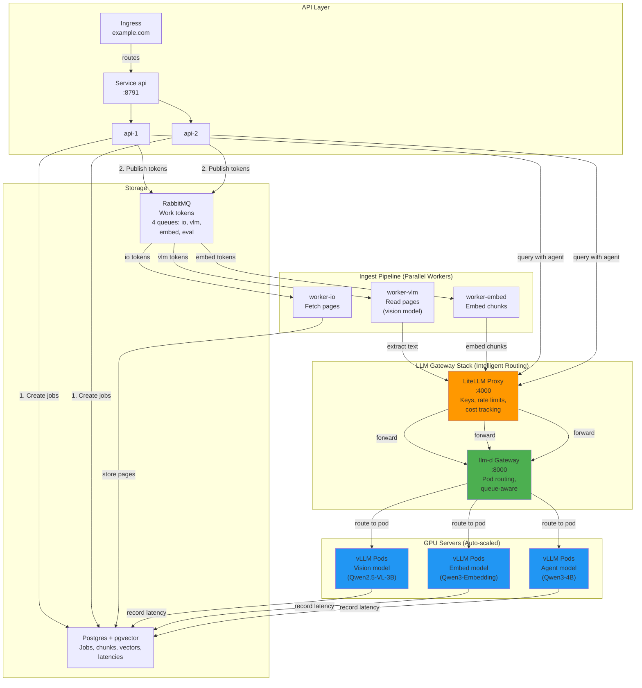
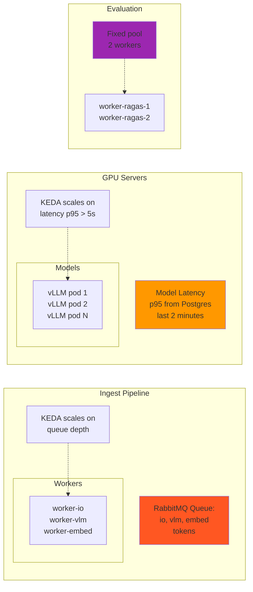
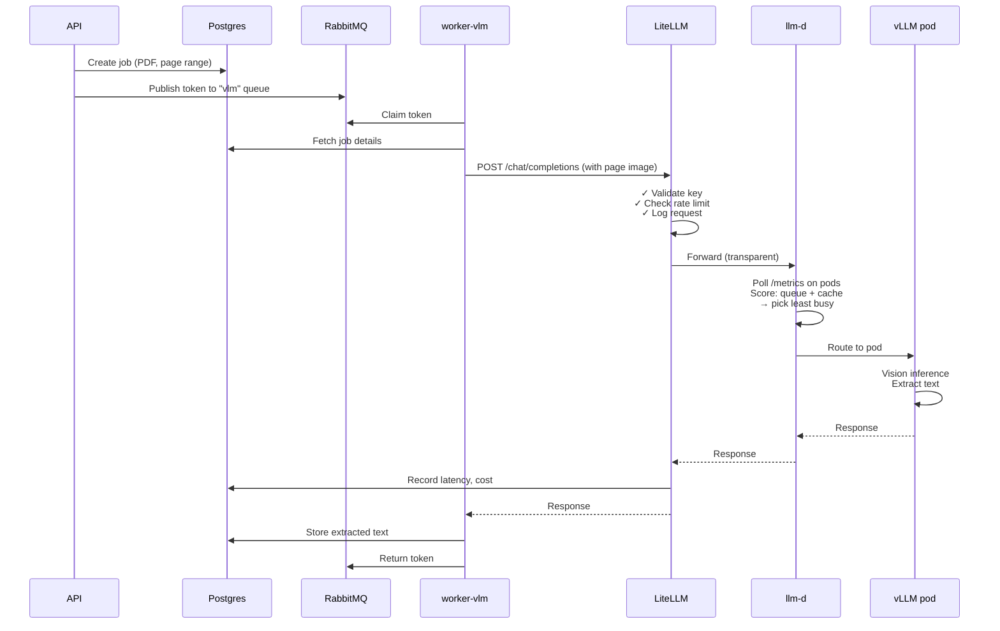
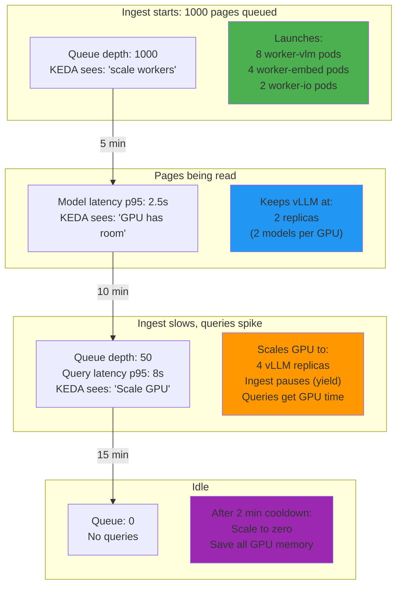
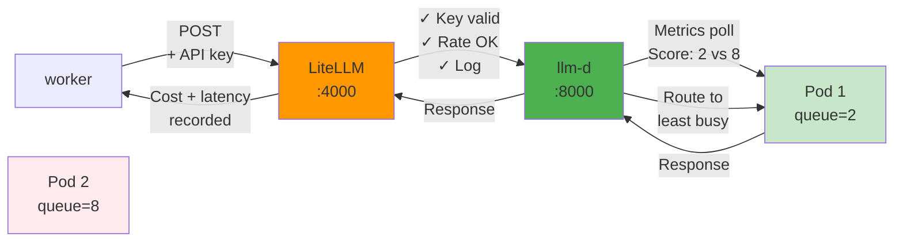

# DocuFlow: What It Is & How It Works

**Document ingestion + RAG on Kubernetes. Read scanned documents with vision, make them searchable, answer questions.**

---

## System Architecture



---

## Three Workloads, One GPU

**Problem:** Reading 10,000 scanned documents while serving live queries on a single GPU.

**Solution:** Three independent auto-scaling strategies.



---

## Data Flow: One Request



---

## Scaling in Action



---

## Request Routing: LiteLLM + llm-d

Workers send all requests through **two intelligent layers:**



**Layer 1 (LiteLLM):** API keys, rate limits, cost tracking, logging  
**Layer 2 (llm-d):** Pod discovery, queue-aware routing, health checks  

---

## The Three Pipelines

### 1. Ingest: Read & Index Documents
```
PDF → io worker (fetch pages)
      ↓
   vlm worker (vision: read text)
      ↓
   embed worker (embeddings)
      ↓
   Postgres (chunks + vectors)
```
**Scales on:** RabbitMQ queue depth (0 to 16+ pods)  
**Speed:** 100-200 pages/min on one GPU

### 2. Query: Agent + Search
```
User question → api (search) → vLLM agent
                     ↓
            pgvector (retrieve chunks)
                     ↓
                Agent loop
                     ↓
            Answer + sources
```
**Scales on:** Query latency p95 (1 to 8 GPU pods)  
**Latency:** <15s p95 during ingest

### 3. Eval: Quality Metrics
```
Ingest results → worker-ragas (RAGAS eval)
                      ↓
              Postgres (eval_results)
```
**Fixed:** 2 workers (not auto-scaled)  
**Metrics:** Faithfulness, relevancy, context precision

---

## Tech Stack

| Layer | Tech | Why |
|-------|------|-----|
| **API** | Python FastAPI | Simple, Async I/O |
| **Ingest Queue** | RabbitMQ | Work tokens (KEDA scales on it) |
| **Job State** | Postgres + pgvector | Source of truth |
| **Vision & LLM** | vLLM (Qwen models) | Fast inference, batching |
| **Routing** | LiteLLM + llm-d | App policy + K8s intelligence |
| **Scaling** | KEDA | Reacts to queue depth & latency |
| **Container Orch** | Kubernetes | Pod scaling, networking, monitoring |

---

## Performance: What to Expect

| Metric | Value | Notes |
|--------|-------|-------|
| Ingest speed | 100-200 pages/min | Single GPU, parallel workers |
| Extract latency p95 | 2-5 sec | Per page (varies by page size) |
| Query latency p95 | <15 sec | During ingest (scales GPU if higher) |
| Cost per page | $0.01-0.05 | Depends on page size + model |
| Eval latency | 30-60 sec | Per query (RAGAS) |
| Max concurrent docs | 10,000+ | Limited by Postgres, not GPU |

---

## Next: Deployment & Operations

See [Part 2: Operate & Scale](02-deploy-monitor-gateway.md) for:
- Kubernetes manifests (all-in-one YAML)
- SQL monitoring queries
- Troubleshooting & scaling guidelines
- Cost optimization

---

**Files:**
- Architecture: `k8s/base/llm-stack-combined.yaml` (complete stack)
- Deployment: `k8s/APPLY_LITELLM_STACK.md` (step-by-step)
- Setup guide: `docs/LITELLM_LLMD_SETUP.md` (detailed config)
