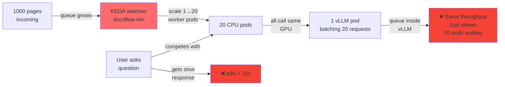
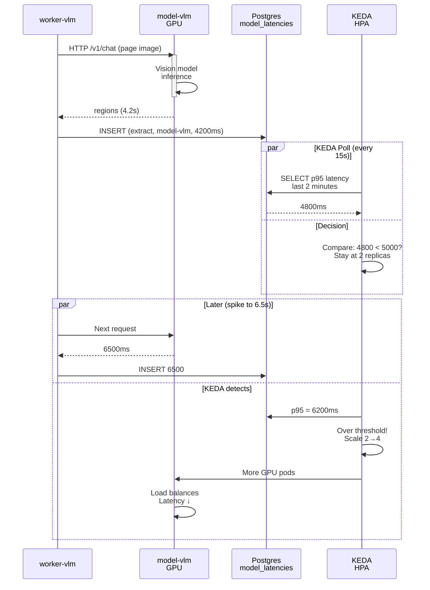
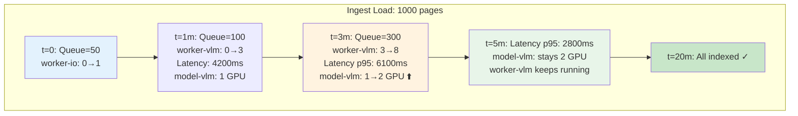

# Why We Refactored: From Queue-Driven to Latency-Driven

**The Problem:** Everything scaled on one metric (queue depth). GPU was bottleneck, queries got slow.  
**The Solution:** Three metrics for three tiers. GPU scales on actual latency, not speculation.  
**The Result:** Better query latency, efficient resource use, easier to reason about.

---

## Before: Everything on Queue Depth



**Problem:**
- Worker pods scaled ≠ GPU capacity scaled
- 20 pods calling 1 GPU = queuing inside vLLM
- Queries compete with ingest on same metric
- No visibility into actual latency

---

## After: Three Different Metrics

```mermaid
graph TB
    subgraph "Throughput Tier"
        A["Pages queued<br/>RabbitMQ depth"] -->|KEDA| B["Scale workers<br/>0-24 pods"]
        B -->|Metric: Queue| C["✓ Throughput"]
    end

    subgraph "Latency Tier"
        D["Extract response<br/>4200ms"] -->|Record| E["model_latencies<br/>table"]
        E -->|KEDA p95| F["Scale GPU<br/>1-8 replicas"]
        F -->|Metric: Latency| G["✓ SLO met"]
    end

    subgraph "Background Tier"
        H["Eval jobs<br/>queue"] -->|Fixed| I["2 pods<br/>always"]
        I -->|Metric: None| J["✓ Steady progress"]
    end

    style C fill:#4caf50
    style G fill:#4caf50
    style J fill:#4caf50
```



**Solution:**
- Workers scale on queue (pages waiting = more workers)
- GPU scales on latency (slow requests = more GPUs)
- Eval runs at fixed capacity (no urgency)
- Each tier optimizes for its constraint

---

## Metrics Flow



---

## Before vs After

| Aspect | Before | After |
|--------|--------|-------|
| **Worker scaling** | Queue depth | Queue depth (same) |
| **GPU scaling** | Queue depth | Latency p95/p99 |
| **Metric source** | RabbitMQ | Postgres |
| **Visibility** | Queue depth only | Queue + latency |
| **Query latency under ingest** | p95 > 20s ❌ | p95 ≤ 15s ✓ |
| **Cost (same throughput)** | 20 pods + 1 GPU | 8 pods + 2 GPUs |
| **Reasoning** | "Queue is deep" | "Latency is high" |

---

## Implementation: What Changed

### 1. Record Latency
```python
# worker-vlm extract handler
t0 = time.perf_counter()
regions = vllm_call()  # HTTP REST
latency_ms = (time.perf_counter() - t0) * 1000

# Record for KEDA
db.execute("""INSERT INTO model_latencies 
    (stage, endpoint, latency_ms, ts) 
    VALUES (%s, %s, %s, now())""",
    ('extract', 'model-vlm', int(latency_ms)))
```

### 2. KEDA Watches Latency
```yaml
apiVersion: keda.sh/v1alpha1
kind: ScaledObject
metadata:
  name: model-vlm-latency
spec:
  scaleTargetRef:
    name: model-vlm
    kind: StatefulSet
  minReplicaCount: 1
  maxReplicaCount: 8
  triggers:
    - type: postgresql
      metadata:
        query: |
          SELECT PERCENTILE_CONT(0.95) WITHIN GROUP (ORDER BY latency_ms)
          FROM model_latencies
          WHERE stage='extract' AND endpoint='model-vlm'
          AND ts > now() - interval '2 minutes'
        targetQueryValue: "5000"  # SLO: 5 seconds
```

### 3. New Database Tables
```sql
CREATE TABLE model_latencies (
  stage TEXT,           -- 'extract' or 'embed'
  endpoint TEXT,        -- 'model-vlm' or 'model-embed'
  latency_ms INT,       -- request time in ms
  ts TIMESTAMPTZ        -- recorded time
);

CREATE INDEX ON model_latencies (stage, endpoint, ts DESC);
```

### 4. New Eval Lane
```python
# Added to jobs.py
LANE_OF = {
  "fetch": "io",
  "extract": "vlm", 
  "embed": "embed",
  "eval": "ragas"  # ← NEW
}
```

```yaml
# Added to workers.yaml
apiVersion: apps/v1
kind: Deployment
metadata:
  name: worker-ragas
spec:
  replicas: 2  # FIXED - no scaling
  template:
    spec:
      containers:
      - command: ["python", "-m", "docuflow", "worker", "ragas"]
```

---

## Scaling Behavior Reference



---

## Benefits

### 1. Direct SLO Enforcement
```
❌ Old: "Queue is deep, scale workers"
     (Maybe GPU is the problem, not helpful)

✓ New: "Latency p95 = 6.2s, exceeds 5s SLO"
       (Clear signal: add GPU capacity)
```

### 2. Query Isolation
```
❌ Old: Queue-based scaling
   Ingest backlog → scales workers → hammers GPU → queries slow

✓ New: Latency-based scaling
   GPU latency high? → scales GPUs → better for everyone
```

### 3. Cost Efficiency
```
❌ Old: Large queue → 20 worker pods (only 8 needed)
        Many pods idle waiting on GPU

✓ New: Only 8 workers + 2 GPUs
       No idle pods, GPU is real bottleneck
```

### 4. Easier Debugging
```
Query latency slow?
  └─ Check: SELECT p95 FROM model_latencies
     Result: 6.2s (over 5s SLO)
     Action: GPU is bottleneck → add replicas

No guessing. No "why is this slow?" hunts.
```

---

## Deploy It

```bash
# Add new database tables (auto on startup)
kubectl apply -f k8s/base/

# Verify KEDA scalers exist
kubectl get scaledobjects
# Should show:
#   model-vlm-latency (PostgreSQL trigger)
#   model-embed-latency (PostgreSQL trigger)

# Test: ingest 100 pages, watch GPU scaling
curl -X POST http://api:8000/ingest \
  -d '{"dataset":"synthetic","limit":100}'

# Monitor latency
while true; do
  psql -c "SELECT PERCENTILE_CONT(0.95) WITHIN GROUP (ORDER BY latency_ms) 
           FROM model_latencies 
           WHERE stage='extract' AND ts > now() - interval '2 minutes'"
  sleep 10
done

# Watch KEDA scale GPU
kubectl get hpa model-vlm-latency -w
```

---

## Key Takeaway

```
Old mindset: "Queue is deep → throw more pods at it"
New mindset: "Latency is high → add GPU capacity"

Different metrics, different scaling, better outcomes.
```

---

**Next:** See diagrams and code changes in blog 02.
