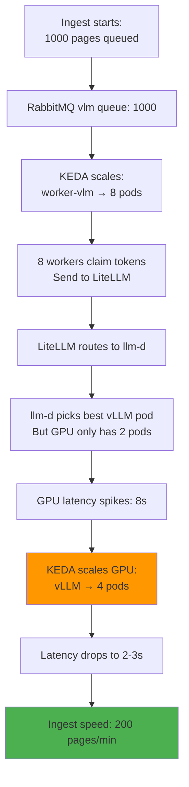

# Deploying & Operating DocuFlow

**From zero to ingesting documents on Kubernetes in 3 commands.**

---

## Deploy Everything

```bash
# 1. Deploy the complete stack (LiteLLM + llm-d + vLLM + KEDA)
kubectl apply -f k8s/base/llm-stack-combined.yaml

# 2. Deploy workers and API
kubectl apply -f k8s/base/workers.yaml
kubectl apply -f k8s/base/api.yaml

# 3. Patch workers to use LiteLLM gateway
kubectl patch deployment worker-vlm -p '{"spec":{"template":{"spec":{"containers":[{"name":"worker","envFrom":[{"configMapRef":{"name":"docuflow-config-litellm"}},{"secretRef":{"name":"docuflow-secrets"}}]}]}}}}'

kubectl patch deployment worker-embed -p '{"spec":{"template":{"spec":{"containers":[{"name":"worker","envFrom":[{"configMapRef":{"name":"docuflow-config-litellm"}},{"secretRef":{"name":"docuflow-secrets"}}]}]}}}}'
```

**Done.** System is live.

---

## Verify Deployment

```bash
# Pods running?
kubectl get pods
# Should see: litellm-proxy, model-vlm, worker-vlm, worker-embed, api, postgres, rabbitmq

# Gateway ready?
kubectl get gateway llm-d-gateway
# Should show: Ready

# vLLM metrics accessible?
kubectl port-forward model-vlm-0 8000:8000 &
curl localhost:8000/metrics | grep queue_depth
# Should show: vllm_queue_depth 0
```

---

## Monitoring: 3 Key Queries

### 1. What's the ingest speed?
```sql
SELECT 
  COUNT(*) / EXTRACT(EPOCH FROM (max(updated_at) - min(updated_at))) as pages_per_second,
  COUNT(*) as total_pages
FROM jobs
WHERE status = 'done' AND updated_at > now() - interval '5 minutes';
```
**Target:** 2-3 pages/sec (120-180 pages/min)

### 2. Is the GPU keeping up?
```sql
SELECT 
  stage,
  PERCENTILE_CONT(0.95) WITHIN GROUP (ORDER BY latency_ms) as p95_latency_ms,
  COUNT(*) as requests
FROM model_latencies
WHERE ts > now() - interval '2 minutes'
GROUP BY stage;
```
**Target:** extract < 5000ms, embed < 3000ms

### 3. How much queue depth?
```bash
# Via kubectl
kubectl get hpa model-vlm-latency -o jsonpath='{.status.currentReplicas}'
# Shows current GPU pod count

# Via Postgres (KEDA metric source)
SELECT 
  PERCENTILE_CONT(0.95) WITHIN GROUP (ORDER BY latency_ms) as p95
FROM model_latencies
WHERE ts > now() - interval '2 minutes'
GROUP BY 1;
# If p95 > 5000ms, KEDA will scale up
```

---

## Troubleshooting

### "Requests are slow (p95 > 5s)"

```bash
# 1. Check GPU pod count
kubectl get pods -l app=model-vlm
# If only 1 pod and p95 > 5s, KEDA should scale

# 2. Check KEDA is working
kubectl describe hpa model-vlm-latency | grep -A 5 "Current"

# 3. Check vLLM metrics
kubectl exec -it model-vlm-0 -- curl localhost:8000/metrics | grep -E "queue|cache"

# 4. If metrics are wrong, restart vLLM
kubectl delete pods -l app=model-vlm
```

### "Workers aren't getting requests"

```bash
# 1. Check queue has tokens
kubectl exec -it rabbitmq-0 -- rabbitmqctl list_queues name messages
# Should show vlm queue with pending messages

# 2. Check workers are running
kubectl get deploy worker-vlm -o jsonpath='{.status.desiredReplicas},{.status.readyReplicas}'

# 3. Check worker logs
kubectl logs deployment/worker-vlm | head -20
# Look for connection errors or auth failures
```

### "LiteLLM proxy is rejecting requests"

```bash
# 1. Check key validation
kubectl logs deployment/litellm-proxy | grep -i "unauthorized\|401"

# 2. Check rate limit
kubectl logs deployment/litellm-proxy | grep -i "rate_limit\|429"

# 3. Check backend (llm-d) is responding
kubectl logs deployment/litellm-proxy | grep -i "llm-d\|gateway"
```

---

## Scaling Behavior



---

## Cost Optimization

### GPU Usage

```sql
-- How much did GPU serve ingest vs queries?
SELECT 
  (SELECT COUNT(*) FROM model_latencies 
   WHERE stage = 'extract') as extract_requests,
  (SELECT COUNT(*) FROM model_latencies 
   WHERE stage = 'embed') as embed_requests,
  (SELECT COUNT(*) FROM model_latencies 
   WHERE endpoint LIKE 'agent%') as query_requests
FROM model_latencies LIMIT 1;
```

**Strategy:**
- **Ingest-heavy?** More worker pods, fewer GPU pods
- **Query-heavy?** Fewer worker pods, more GPU pods  
- **Balanced?** Fix at 4 GPU pods + dynamic worker scaling

### RabbitMQ Usage

```bash
# How much queue depth?
kubectl exec rabbitmq-0 -- rabbitmqctl list_queues name messages | grep vlm
# If always near zero: workers are fast enough, don't add more
# If always > 100: Add more worker pods (cheap)
```

### Postgres Cleanup

```bash
# Run garbage collection (removes old jobs)
python -m docuflow gc
# Removes jobs > 7 days old, queries > 30 days old
# Schedule daily: see k8s/base/gc-cronjob.yaml
```

---

## Monitoring Dashboard (SQL)

Save as a SQL file and run periodically:

```sql
-- DocuFlow System Health Check

WITH ingest_speed AS (
  SELECT 
    COUNT(*) / EXTRACT(EPOCH FROM (max(updated_at) - min(updated_at))) as pages_per_sec
  FROM jobs
  WHERE status = 'done' AND updated_at > now() - interval '5 minutes'
),

gpu_latency AS (
  SELECT 
    stage,
    PERCENTILE_CONT(0.95) WITHIN GROUP (ORDER BY latency_ms) as p95_ms
  FROM model_latencies
  WHERE ts > now() - interval '2 minutes'
  GROUP BY stage
),

queue_depth AS (
  SELECT 
    COALESCE(SUM(CASE WHEN status='queued' THEN 1 END), 0) as queued,
    COALESCE(SUM(CASE WHEN status='running' THEN 1 END), 0) as running
  FROM jobs
  WHERE created_at > now() - interval '1 hour'
)

SELECT 
  (SELECT pages_per_sec FROM ingest_speed) as "Pages/Sec",
  (SELECT p95_ms FROM gpu_latency WHERE stage='extract') as "Extract p95 (ms)",
  (SELECT p95_ms FROM gpu_latency WHERE stage='embed') as "Embed p95 (ms)",
  (SELECT queued FROM queue_depth) as "Queued Jobs",
  (SELECT running FROM queue_depth) as "Running Jobs";
```

---

## Configuration Tuning

### Increase ingest speed

1. **Add more worker pods:**
   ```bash
   kubectl scale deploy worker-vlm --replicas=16
   ```

2. **Increase GPU pods:**
   ```bash
   # Edit KEDA ScaledObject in llm-stack-combined.yaml
   maxReplicaCount: 8  # → 12
   ```

3. **Increase batch size:**
   ```bash
   # Edit vLLM StatefulSet args
   --max-num-batched-tokens=16384  # → 32768
   ```

### Reduce costs

1. **Scale to zero when idle:**
   ```bash
   # KEDA already does this (2min cooldown)
   ```

2. **Use smaller model:**
   ```bash
   # Edit vLLM_MODEL in docuflow-config-litellm
   VLM_MODEL: "Qwen2.5-VL-3B"  # → "Qwen2.5-VL-2B"
   ```

3. **Reduce eval frequency:**
   ```bash
   # Edit k8s/base/workers.yaml
   # Only evaluate 10% of queries instead of all
   ```

---

## The Three Metrics KEDA Watches

| Metric | Source | When to Scale | Max |
|--------|--------|---------------|-----|
| **Queue Depth** | RabbitMQ | Tokens waiting | 16 pods per lane |
| **Latency p95** | Postgres | Inference slow | 8 GPU pods |
| **Fixed Pool** | Code | Eval jobs | 2 pods (no scaling) |

---

## Alerting

Set these up in Prometheus/Grafana:

```yaml
- alert: IngestTooSlow
  expr: (SELECT pages_per_sec FROM ingest_speed) < 1
  for: 5m
  action: "Add worker pods"

- alert: GPULatencyHigh
  expr: (SELECT p95_ms FROM gpu_latency WHERE stage='extract') > 5000
  for: 2m
  action: "KEDA should scale; check if maxReplicaCount reached"

- alert: QueueOverflow
  expr: (SELECT queued FROM queue_depth) > 1000
  for: 10m
  action: "Ingest bottleneck; scale workers or GPU"
```

---

## Next Steps

1. **Deploy** with the 3 commands above
2. **Monitor** with the SQL queries (every 5 min)
3. **Tune** based on your latency targets
4. **Automate** with cron job for SQL dashboards

For detailed architecture, see [Part 1: What It Is](01-docuflow-system.md)  
For gateway setup details, see `docs/LITELLM_LLMD_SETUP.md`

---

**Files:**
- Complete stack: `k8s/base/llm-stack-combined.yaml`
- Deployment steps: `k8s/APPLY_LITELLM_STACK.md`
- Gateway tuning: `docs/LITELLM_LLMD_SETUP.md`
