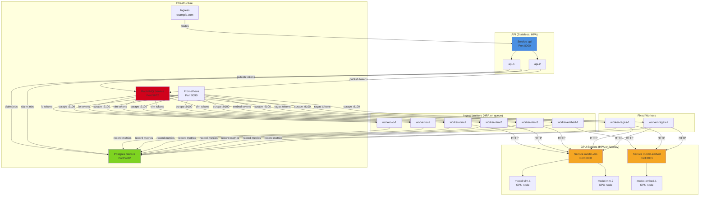
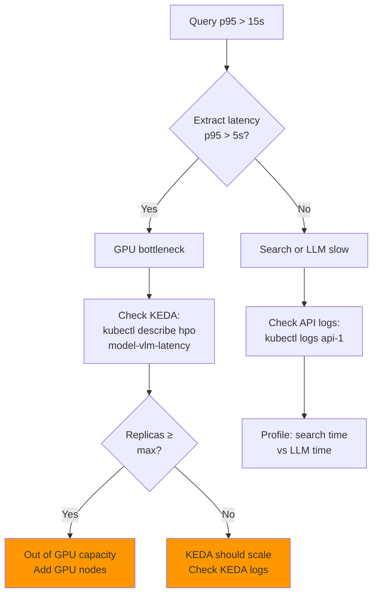
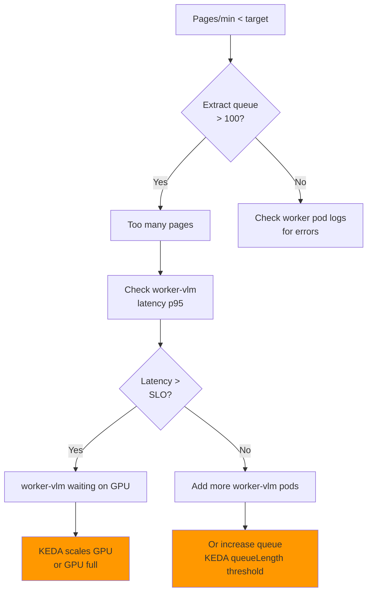

# Operating DocuFlow: Monitor, Scale, Troubleshoot

**Deploy once, monitor everywhere.**

---

## Pod & Service Map



---

## Monitoring Queries

### Queue Depth (Ingest Backlog)
```sql
-- What work is waiting?
SELECT lane, COUNT(*) as queued, COUNT(*) FILTER(WHERE status='running') as running
FROM jobs
WHERE status IN ('queued', 'running')
GROUP BY lane;

-- Expected output:
-- lane | queued | running
-- io   |     50 |       2
-- vlm  |    300 |       8
-- embed|    100 |       3
-- ragas|     10 |       0
```

### Worker Pod Count (Should match queue depth)
```bash
# Current replica counts
kubectl get deploy -l app.kubernetes.io/component=worker -o wide
kubectl get hpa -o wide

# Example:
# NAME             DESIRED   CURRENT   READY   AGE
# worker-io        2         2         2       2h
# worker-vlm       8         8         8       2h
# worker-embed     2         2         2       2h
# worker-ragas     2         2         2       2d
```

### Model Latency (GPU Health)
```sql
-- Extract model p95 latency (last 2 minutes)
SELECT 
  PERCENTILE_CONT(0.95) WITHIN GROUP (ORDER BY latency_ms) as p95_ms,
  AVG(latency_ms) as avg_ms,
  COUNT(*) as requests
FROM model_latencies
WHERE stage='extract' AND endpoint='model-vlm'
  AND ts > now() - interval '2 minutes';

-- Expected: p95 < 5000ms (5 sec SLO)

-- Embed model p95 latency
SELECT 
  PERCENTILE_CONT(0.95) WITHIN GROUP (ORDER BY latency_ms) as p95_ms,
  COUNT(*) as requests
FROM model_latencies
WHERE stage='embed' AND endpoint='model-embed'
  AND ts > now() - interval '2 minutes';

-- Expected: p95 < 3000ms (3 sec SLO)
```

### Query Performance
```sql
-- Interactive query latency
SELECT 
  COUNT(*) as queries_5min,
  PERCENTILE_CONT(0.95) WITHIN GROUP (ORDER BY seconds) as p95_latency,
  MAX(seconds) as max_latency
FROM queries
WHERE created_at > now() - interval '5 minutes';

-- Expected: p95 < 15s during ingest, <5s idle
```

### GPU Pod Status
```bash
# Are GPU pods healthy?
kubectl get pods -l app=model-vlm
kubectl logs -f deployment/model-vlm --tail=20

# Check GPU memory
kubectl exec -it model-vlm-0 -- nvidia-smi

# Check vLLM is serving requests
curl http://model-vlm:8000/v1/models
```

---

## Troubleshooting

### "Queries Are Slow"



### "Ingest Is Slow"



### "KEDA Not Scaling"

```bash
# 1. Check KEDA operator is running
kubectl get pods -n keda

# 2. Check ScaledObjects exist
kubectl get scaledobjects
# Should show: model-vlm-latency, model-embed-latency, worker-vlm, etc.

# 3. Check KEDA logs for errors
kubectl logs -n keda deployment/keda-operator | grep -i error

# 4. Manually check KEDA metric source
# For PostgreSQL triggers:
psql -c "SELECT COUNT(*) FROM model_latencies WHERE ts > now() - interval '2 minutes'"

# For RabbitMQ triggers:
rabbitmqctl list_queues name messages

# 5. Check HPA status
kubectl describe hpa model-vlm-latency
# Look for: conditions, current/desired replicas, events
```

---

## Key Alerts

```yaml
# Prometheus alert rules to set up

- alert: VLMLatencyHighSLO
  expr: |
    avg(avg_over_time(model_latency_p95_ms{stage="extract"}[2m])) > 5000
  for: 2m
  annotations:
    summary: "Extract latency exceeds 5s SLO"

- alert: EmbedLatencyHighSLO
  expr: |
    avg(avg_over_time(model_latency_p95_ms{stage="embed"}[2m])) > 3000
  for: 2m
  annotations:
    summary: "Embed latency exceeds 3s SLO"

- alert: QueryLatencyHighSLO
  expr: |
    query_latency_p95_seconds > 15
  for: 5m
  annotations:
    summary: "Query p95 latency exceeds 15s"

- alert: WorkerPodsCrashing
  expr: |
    rate(kube_pod_container_status_restarts_total{pod=~"worker-.*"}[1h]) > 0.01
  annotations:
    summary: "Worker pods restarting frequently"

- alert: PostgresLag
  expr: |
    pg_replication_lag_seconds > 10
  annotations:
    summary: "Postgres replication lag > 10s"
```

---

## Scaling Guidelines

```
Ingest Queue Depth | Action
─────────────────────────────
0-10 tokens        | 1 worker pod (scale to 0 after 2m idle)
10-50              | 2-4 pods
50-200             | 4-8 pods
200-500            | 8-16 pods
500+               | 16+ pods (check GPU isn't bottleneck)

Model Latency p95  | Action
─────────────────────────────
< 2000ms           | Scale down GPU (after 5m low)
2000-5000ms        | Optimal zone
5000-7000ms        | Scale up GPU
7000ms+            | Check GPU memory, out of capacity
```

---

## Cost Optimization

```
High CPU, low GPU = Add more workers (cheap)
High latency, high GPU = Add GPU capacity (expensive)
Check:
  1. kubectl top nodes (GPU node utilization)
  2. NVIDIA SMI (per-GPU memory)
  3. model_latencies table (actual latency)
```

---

## Deployment Checklist

- [ ] Postgres initialized (auto on pod start)
- [ ] RabbitMQ queues declared (auto via broker.py)
- [ ] KEDA metrics (check PostgreSQL connectivity)
- [ ] Worker liveness probes passing (curl :9100/health)
- [ ] Model servers returning 200 on /health
- [ ] First ingest: 0 errors
- [ ] Query latency p95 < 15s with ingest running
- [ ] KEDA scaling pods up/down on signal changes

---

**Next:** See `docs/ARCHITECTURE_DIAGRAM.md` for detailed flows.
