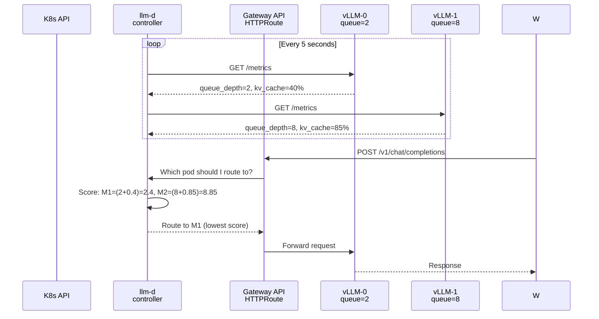

# Intelligent Routing: Gateway API + llm-d vs LiteLLM Proxy

**Quick clarification:**
- **LiteLLM:** External proxy (like a firewall/gateway)
- **llm-d:** Kubernetes-native pod management (built-in to K8s)

We should use **Gateway API + llm-d** for K8s-native intelligence.

---

## Architecture Comparison

### Option 1: LiteLLM Proxy (External Proxy)
```mermaid
graph TB
    W["worker-vlm<br/>pods"]
    GW["LiteLLM Proxy<br/>Deployment<br/>Port 8000<br/>routes requests<br/>external process"]
    P1["model-vlm-0<br/>vLLM"]
    P2["model-vlm-1<br/>vLLM"]
    
    W -->|HTTP| GW
    GW -->|HTTP| P1 & P2
    
    style GW fill:#ff9800
    note on diagram right of GW: "External proxy<br/>Has to query metrics<br/>2-5ms overhead<br/>Extra deployment"
```

**Pros:** Flexible, can run anywhere  
**Cons:** Extra layer, polling overhead, separate deployment

---

### Option 2: Gateway API + llm-d (Kubernetes-Native) ✓
```mermaid
graph TB
    subgraph "Kubernetes Control Plane"
        API["API Server<br/>knows about pods"]
        GW["Gateway API<br/>HTTPRoute resource"]
        LLMD["llm-d controller<br/>watches vLLM metrics<br/>routes intelligently"]
    end
    
    W["worker-vlm<br/>pods"]
    SVC["Service: model-vlm<br/>discovered by Gateway API"]
    P1["model-vlm-0<br/>vLLM<br/>+metrics"]
    P2["model-vlm-1<br/>vLLM<br/>+metrics"]
    
    W -->|HTTP| GW
    GW -->|"direct to pods<br/>via llm-d"| P1 & P2
    
    LLMD -->|watches| P1 & P2
    LLMD -->|informs| GW
    API -->|Pod events| LLMD
    
    style LLMD fill:#4caf50
    note on diagram right of LLMD: "Kubernetes-native<br/>Pod-aware<br/>No extra latency<br/>Integrated control"
```

**Pros:** K8s-native, pod-aware, no extra network hops  
**Cons:** Requires K8s 1.28+, llm-d controller

---

## How llm-d Routes Intelligently



---

## Key Resources

### GatewayClass (controller selection)
```yaml
apiVersion: gateway.networking.k8s.io/v1beta1
kind: GatewayClass
metadata:
  name: llm-d
spec:
  controllerName: "llm.ai/llm-d"  # Use llm-d, not Envoy or nginx
```

### HTTPRoute (path routing)
```yaml
apiVersion: gateway.networking.k8s.io/v1beta1
kind: HTTPRoute
metadata:
  name: extract-route
spec:
  parentRefs:
  - name: llm-gateway
  rules:
  - backendRefs:
    - name: model-vlm  # Service name
      port: 8000
      weight: 100      # llm-d distributes via weight
```

### LLMServicePolicy (the magic - llm-d specific)
```yaml
apiVersion: llm.ai/v1alpha1
kind: LLMServicePolicy
metadata:
  name: extract-policy
spec:
  targetRef:
    kind: Service
    name: model-vlm
  
  routing:
    strategy: "least_pending_requests"  # llm-d knows vLLM metrics
    metrics:
      - type: "vllm_queue_depth"        # Query /metrics endpoint
      - type: "vllm_kv_cache_utilization"
      - type: "vllm_batch_utilization"
```

---

## Comparison Table

```
╔════════════════════════╦═══════════════════╦═══════════════════╗
║ Feature                ║ LiteLLM Proxy     ║ llm-d Gateway API ║
╠════════════════════════╬═══════════════════╬═══════════════════╣
║ Type                   ║ External proxy    ║ K8s-native        ║
║ Routing awareness      ║ vLLM metrics      ║ vLLM metrics      ║
║ Network hops           ║ +1 (proxy layer)  ║ Direct            ║
║ Per-request latency    ║ 2-5ms overhead    ║ <1ms overhead     ║
║ Pod discovery          ║ Manual config     ║ Automatic via K8s ║
║ Autoscaling aware      ║ Polling via API   ║ Pod events        ║
║ Health checking        ║ Configurable      ║ Built-in          ║
║ Load shedding (503)    ║ ✓                 ║ ✓                 ║
║ Setup complexity       ║ Medium            ║ Medium            ║
║ Extra deployment       ║ ✓ (LiteLLM pods) ║ ✗ (built-in)      ║
║ Kubernetes version     ║ Any               ║ 1.28+             ║
║ Best for               ║ Multi-cloud       ║ Pure K8s clusters ║
╚════════════════════════╩═══════════════════╩═══════════════════╝
```

---

## Current State vs With llm-d

### Current (K8s Service Round-Robin)
```
worker → Service model-vlm → [Pod-1 queue=15] [Pod-2 queue=20] [Pod-3 queue=2]
                              Round-robin picks Pod-2 (BUSY!) ❌
```

### With llm-d
```
worker → Gateway API → llm-d controller → Pod-3 (queue=2) ✓
                       (queries /metrics)
```

---

## When to Use What

| Scenario | Use This |
|----------|----------|
| Single K8s cluster (GKE, EKS, AKS) | **llm-d Gateway API** |
| Multi-cloud, hybrid setup | LiteLLM Proxy |
| Need advanced features (keys, budgets, billing) | LiteLLM Proxy |
| Simple intelligent routing | **llm-d Gateway API** |
| K8s < 1.28 | LiteLLM Proxy |

---

## Deployment

### Install llm-d Controller
```bash
# Add llm-d to your cluster (varies by distribution)
# For reference implementations:
helm repo add llm-d https://charts.llm-d.io
helm install llm-d llm-d/llm-d-controller
```

### Deploy Gateway API Resources
```bash
# Apply the Gateway API resources
kubectl apply -f k8s/base/llm-gateway-correct.yaml

# Verify gateway is ready
kubectl get gatewayclass
kubectl get gateway llm-gateway
kubectl get httproute

# Check llm-d is routing
kubectl logs -n llm-d deployment/llm-d-controller | grep routing
```

### Worker Config Change
```python
# OLD: Direct to vLLM
response = httpx.post("http://model-vlm:8000/v1/chat/completions", ...)

# NEW: Through Gateway API (llm-d routes)
response = httpx.post("http://llm-gateway:8000/v1/chat/completions", ...)
```

---

## Files Provided

```
k8s/base/llm-gateway-correct.yaml
  ├─ GatewayClass: llm-d controller
  ├─ Gateway: Listens on :8000
  ├─ HTTPRoute: Routes to model-vlm & model-embed
  ├─ LLMServicePolicy: Intelligent routing config
  ├─ vLLMMonitor: Tells llm-d what to watch
  ├─ BackendTrafficPolicy: Health checks & load balancing
  └─ ServiceExport: Publish services to Gateway API
```

---

## Summary

```
Old thinking: "Need a proxy between workers and vLLM"
New thinking: "Use K8s Gateway API with llm-d"

Reason: llm-d is PURPOSE-BUILT for this:
  - Understands vLLM metrics natively
  - Integrated with Kubernetes pod lifecycle
  - Direct routing (no extra network hop)
  - Automatic pod discovery
  - Works with KEDA (sees when pods scale)
```

**Result:** Intelligent routing without external proxy overhead.

---

**Status:**
- ✓ Current: K8s Service (simple)
- 📦 Ready to deploy: llm-d Gateway API (smart)
- 📦 Alternative: LiteLLM Proxy (flexible)

Choose based on your cluster type and needs!
