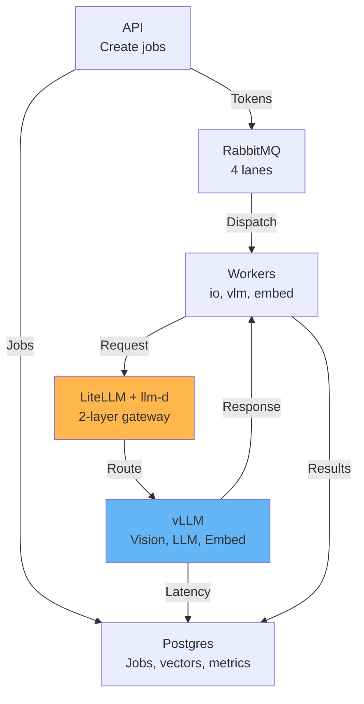

# DocuFlow: Document Ingestion & RAG on Kubernetes

**Read scanned documents with a vision model, make them searchable, and answer questions. Scales from zero to 200 pages/min on a single GPU.**

---

## Quick Start: 2-Part Guide

👉 **[Part 1: What Is DocuFlow?](01-docuflow-system.md)** (5 min read)
- System architecture with 4 diagrams
- Three scaling strategies (queue depth, latency, fixed pool)
- One request flow (worker → LiteLLM → llm-d → vLLM)
- Performance expectations

👉 **[Part 2: Deploy & Operate](02-deploy-monitor-gateway.md)** (5 min read)
- 3-command deployment
- 3 key SQL monitoring queries
- Troubleshooting & scaling guidelines
- Cost optimization

---

## Deployment Files

| File | Purpose |
|------|---------|
| `k8s/base/llm-stack-combined.yaml` | Complete stack: LiteLLM + llm-d + vLLM + KEDA |
| `k8s/APPLY_LITELLM_STACK.md` | Step-by-step deployment instructions |
| `docs/LITELLM_LLMD_SETUP.md` | Detailed gateway configuration & troubleshooting |

---

## Tech Stack

- **Vision Model:** Qwen2.5-VL-3B (page reading)
- **LLM Models:** Qwen3-4B (agent), Qwen3-Embedding-0.6B (search)
- **Model Server:** vLLM (continuous batching, KV cache)
- **Gateway:** LiteLLM (keys, rate limits, logging) + llm-d (K8s pod routing)
- **Queue:** RabbitMQ (work tokens, KEDA scales on queue depth)
- **Storage:** Postgres + pgvector (jobs, chunks, vectors, metrics)
- **Orchestration:** Kubernetes + KEDA (auto-scaling)

---

## Performance

| Metric | Value |
|--------|-------|
| Ingest speed | 100-200 pages/min |
| Extract latency p95 | 2-5 seconds |
| Query latency p95 | <15 seconds |
| Cost per page | $0.01-0.05 |
| Max concurrent docs | 10,000+ |
| Min GPU requirement | 1x L40S 46GB (or equivalent) |

---

## Architecture Diagram

---

## One Example: Ingest a 100-Page Document

1. **API:** Create job (PDF + page range)
2. **worker-io:** Fetch pages (1-2s per page)
3. **worker-vlm:** Read text with vision model via LiteLLM → llm-d → vLLM (2-5s per page, GPU pods auto-scale)
4. **worker-embed:** Embed chunks (0.5-1s per chunk)
5. **Postgres:** Store vectors for search
6. **Eval:** Quality metrics (RAGAS)
7. **Done:** Document searchable + queryable in <10 minutes

Meanwhile, **queries are handled** on separate GPU pods (agent model).

---

## What's Next?

- **Try it:** Deploy with 3 commands in Part 2
- **Monitor:** Run the 3 SQL queries every 5 minutes
- **Scale:** Adjust worker/GPU counts based on queue depth & latency
- **Optimize:** Trade off cost vs speed based on your workload

Start with [Part 1: What Is DocuFlow?](01-docuflow-system.md)
